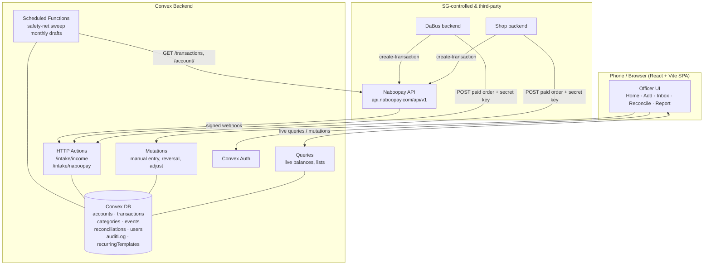

# Architecture — Finance Tracker

| | |
|---|---|
| **Version** | 1.0 |
| **Last Updated** | 2026-10-13 |

## 1. Overview

Finance Tracker is a **reactive monolith**: a React + Vite single-page app talking to a single Convex backend. There is deliberately no separate API server, database server, realtime layer, or cron runner — Convex provides all four. The design philosophy is *computed truth*: no balance is ever stored or typed; every balance is a pure function of an opening balance plus an append-only transaction log. Convex **live queries** push recomputed balances to every connected device the instant a transaction is written, which is what makes "record fast, trust the number" possible. External events (shop/DaBus income, Naboopay webhooks) enter through idempotent HTTP actions; periodic work (safety-net sweep, monthly drafts) runs as scheduled functions.

## 2. System Diagram

## 3. Components

### Frontend — React + Vite SPA
- **Purpose:** Phone-first UI for finance officers.
- **Key pages/routes:** `/` (Home), `/add` (Add transaction), `/review` (Needs-review inbox), `/transactions` (list + filters + CSV), `/events/:id` (Event view), `/reconcile` (Reconcile), `/report` (Review report), `/recurring` (v1.1), `/login`.
- **Framework:** React 18, Vite, TypeScript, React Router, Convex React client.
- **Key responsibilities:** render live balances, capture manual entries in < 10 s, surface the review inbox, never compute financial truth client-side (display only).

### Backend — Convex functions
- **Purpose:** The single source of truth and all business logic.
- **Key modules:** `transactions.ts`, `balances.ts`, `reconciliations.ts`, `recurring.ts`, `http.ts`, `naboopay.ts`, `crons.ts`.
- **Framework:** Convex (queries, mutations, httpAction, scheduled functions).
- **Key responsibilities:** enforce the design rules (computed balances, reason required, nothing deleted, one capture point, transfers neutral, integer FCFA, idempotent intake), write the audit log, verify webhooks over the raw body.

### Database — Convex store
- **Purpose:** Persist the ledger and supporting tables.
- **Tables:** `accounts`, `transactions`, `categories`, `events`, `reconciliations`, `users`, `auditLog`, `recurringTemplates`.
- **Key responsibilities:** hold the append-only transaction log; indexes for balance computation, matching (`source + externalId`, `naboopayReference`), and the review inbox.

### Auth — Convex Auth
- **Purpose:** Gate the app to the closed officer set.
- **Key responsibilities:** authenticate officers, expose identity to mutations so `recordedBy` is trustworthy. Intake keys and the webhook secret are **separate** from user auth.

## 4. Key Data Flows

1. **Officer records a manual expense:** UI form → `mutations.createTransaction` → validates (reason, positive integer amount, account) → inserts transaction + audit entry → live `balances` query recomputes → every device updates.
2. **Shop sale (automatic income):** customer pays via Naboopay → shop backend confirmed → `POST /intake/income` with source key + `externalId` (+ `kind=income`) + `naboopayReference` → httpAction checks key, dedupes on `(source, externalId, kind)`, inserts income (status `confirmed`) on Naboopay account.
3. **Naboopay webhook:** Naboopay `POST /intake/naboopay` → httpAction reads **raw body**, verifies HMAC-SHA256 → matches `order_id` to an income's `naboopayReference`. The webhook **creates nothing**: on a match it confirms, on a non-match it does nothing — removing the webhook-vs-intake race (ADR 0008).
4. **Safety-net sweep (scheduled):** cron calls `GET /transaction/get-transactions` → a paid/done `order_id` still unmatched **after a ~30-min grace window** is inserted once as `needs_review` (deduped by `order_id`, self-healing when the real income arrives). A `part_paid` becomes a `provisional` item, excluded from balances until an officer enters the real amount (ADR 0008, 0013).
5. **Reconciliation:** officer enters real balance → `reconciliations.create` stores computed, real, difference → optional `adjustment_up`/`adjustment_down` transaction with reason → audit entry. A later back-dated entry flips the account to "needs re-checking" (ADR 0010).
6. **Refund:** source calls refund endpoint with original `externalId` → tracker finds the original by `(source, externalId, income)` and writes a reversal keyed `(source, externalId, refund)` — independently idempotent (ADR 0005).
7. **Naboopay payout with fee:** manual "record a payout" takes gross-out and net-in → writes a **transfer of the net amount** + a **"Provider fees" expense** for the fee, keeping transfers neutral (ADR 0015).
8. **Monthly recurring draft (scheduled, v1.1):** cron creates ≤ 1 `draft` expense per active template per month → appears in inbox → officer confirms (edits then counts) or skips (terminal `skipped`, not recreated) (ADR 0012).

## 5. External Services

| Service | Purpose | Notes / Cost |
|---------|---------|--------------|
| Convex | Backend, DB, auth, HTTP, cron, live queries | Free tier likely sufficient for SG volume <!-- assumed --> |
| Naboopay | Payment gateway for shop/DaBus; income & balance data | `…/api/v1`; Bearer auth; no sandbox; rate limit 100 req/60 s; no payout/fee feed |
| Static host (Vite build) | Serve the SPA | Vercel/Netlify free tier <!-- assumed --> |
| Shop backend | Reports confirmed sales to intake | SG-controlled; needs a small integration change |
| DaBus backend | Reports confirmed bookings to intake | SG-controlled; needs a small integration change |

## 6. Scalability Notes

- **Volume** is small (one student government); Convex live queries and the single-table ledger are far within free-tier limits.
- **Balance computation** is O(transactions per account). If a term's volume grows large, add periodic **balance checkpoints** (store a computed balance at a reconciliation point and sum only transactions since) — not needed for v1.
- **Naboopay rate limit** (100 req/60 s): the sweep lists transactions in pages on a schedule rather than calling per-item.
- **Offline:** v1 relies on Convex's native reconnect queue; a persistent IndexedDB outbox can be added later without backend changes, since intake/mutations are idempotent.
